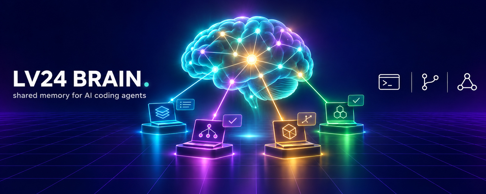

# LV24 Brain

[](https://www.npmjs.com/package/lv24-brain)
[](https://www.npmjs.com/package/lv24-brain)
[](https://github.com/LevapVeeskela/lv24-brain/releases)
[](https://github.com/LevapVeeskela/lv24-brain/pkgs/container/lv24-brain-server)
[](https://brain.lv24.by)
[](LICENSE)
[](go.mod)

**Documentation:** [English](https://brain.lv24.by) · [Русский](https://brain.lv24.by/ru/) · [中文](https://brain.lv24.by/zh/)

> **Your coding agents forget everything between sessions. LV24 Brain doesn't.**
> Claude Code, Codex and OpenCode read the same project memory at the start of
> every session and write back what they decided, what failed and what comes
> next — on every machine you work on. Plain Markdown in your own private git
> repository: no cloud, no vendor lock-in, no database to run.

> **Кратко по-русски.** Общая память проектов для ИИ-агентов и людей: состояние
> проекта, решения, неудачные попытки и handoff'ы между сессиями. Claude Code,
> Codex и OpenCode открывают сессию с контекстом проекта и оставляют итог в
> конце — на всех ваших машинах. Данные — обычный Markdown в вашем приватном
> git-репозитории. Установка: `npm i -g lv24-brain`, затем
> `brain agents sync --hooks`. Документация на русском —
> [brain.lv24.by/ru](https://brain.lv24.by/ru/).

| 🚀 Start | 🧠 Use | 🛠 Run a team |
| --- | --- | --- |
| [Install](#install-in-a-minute) · [See it work](#see-it-work) · [Quickstart](docs/quickstart.md) | [Agent loop](https://brain.lv24.by/loop/) · [MCP tools](https://brain.lv24.by/agents/) · [Search](https://brain.lv24.by/search/) · [CLI](https://brain.lv24.by/reference/cli/) | [Server mode](docs/deploy.md) · [Security](docs/security.md) · [Runbook](docs/runbook.md) · [Update](docs/update.md) |

## See it work

Before a task, an agent (or you) asks for exactly the context it needs:

```text
$ brain context "add retry to sync push"

# myapp — context
goal: ship offline sync for the mobile client
next_action: add retry with backoff to `sync push`

## Review findings
- none

## Latest handoff
- 2026-11-08 summary: queue drains on reconnect; push still fails on 502
  next: add retry with backoff to `sync push`

## Relevant records
- [decision] Retry only idempotent pushes (accepted)
- [note] 502s come from the proxy restart window, ~20 s

## Failed attempts matching the task
- [attempt] Infinite retry loop — hammered the API during the outage
```

One call: state, the last handoff, the decisions and notes that match the task,
and the approaches that already failed — so the next session does not repeat
them. At the end of the session the hook writes a handoff, and the `Decision:`
lines of the agent's final message land in a review inbox.

## Why LV24 Brain

- **Memory that survives the session.** State, decisions, attempts and handoffs
  are written as the work happens and read back at the next start — by any
  agent, on any machine.
- **Works with the agents you use.** Session hooks for Claude Code, Codex and
  OpenCode, plus an MCP server with 16 tools (`brain_open`, `brain_context`,
  `brain_search`, `brain_decision`, …) for anything that speaks MCP.
- **Your data, your repository.** Markdown + YAML in a private git repo you
  own, synced with plain git. Secrets are redacted on every write; this public
  repository never holds brain data.
- **Finds what you mean.** Full-text search that matches English and Russian
  word forms (`decisions` → `decision`, `решений` → `решение`), plus
  `[[id]]` links with backlinks between records.
- **Keeps itself honest.** `brain review` flags stale next steps, answered
  questions, decisions contradicted by later attempts or by changed code,
  broken links and near-duplicates.
- **Safe to keep updated.** Ed25519-signed releases, SHA-256-checked installs,
  `brain update` with rollback, npm packages with provenance.
- **Grows into a team server.** Optional `brain-server` with Postgres,
  per-project access control, scoped API tokens and an audit log
  (`ghcr.io/levapveeskela/lv24-brain-server`).

## Install in a minute

```sh
npm i -g lv24-brain                               # or the signed installers in docs/install.md
brain init --mode local --data-dir ~/brain        # or --mode git with a clone of your private data repo
brain config use ~/brain/brain.yaml
brain project set myapp --path ~/src/myapp
brain agents sync --hooks                         # Claude Code, Codex and OpenCode start with this context
cd ~/src/myapp && brain open
```

That is the whole loop: agents read `brain open` (or `brain context "<task>"`)
at session start and leave a handoff at the end. Next steps:
[quickstart](docs/quickstart.md) · [install options](docs/install.md) ·
[git mode across machines](docs/quickstart.md#2-git-mode) ·
[server mode](docs/deploy.md).

---

- Public engine (this repository): Apache-2.0.
- Private data instance: a separate private data repository, never this repository.
- Product design (source of truth): [docs/product-design.md](docs/product-design.md).

Brain data never lives in this repository. Notes, mail, connector dumps,
journals, indexes, backups, credentials, and machine paths belong in the private
data repository or a local data directory.

## Current status

The engine has moved past the initial scaffold. Implemented and tested today:

| Area | State |
|---|---|
| CLI | `init`, `doctor`, `open`, `project list\|show\|set`, `bootstrap`, `note`, `decision`, `attempt`, `handoff`, `status`, `review`, `sync`, `index [--rebuild]`, `search <query> [--since 7d]`, `context "<task>"` (task-focused context; MCP `brain_context`), `journal`, `event commit`, `hooks`, `config`, `discover`, `graphs`, `agents sync [--check]`, `state get|set`, `record list|show|status|supersede|trash|restore`, `links <id>` / `links --broken` (`[[id]]` links and backlinks between records), `catchup`, `review [--fix]` (findings include `broken-link` and `near-duplicate`), `session start|end` (agent hooks), `mcp` (stdio MCP server for agents), `connector run`, `migrate [--rollback]`, `secret`, `update`, `serve`, `version`, `help`; `login` and `logout` in server mode |
| Storage | Markdown + YAML frontmatter (`fsstore`), SQLite FTS5 index, `registry.json` project index |
| Local search | `brain index` refreshes FTS5 from Markdown; `brain index --rebuild` discards and rebuilds it; `brain search` queries it in local/`git` mode; English and Russian word forms match as a prefix ("decisions" finds "decision", "решений" finds "решение") and `--since` limits by update time. `brain index` is local-only; `brain search` also works in server mode through `GET /v1/search` |
| Git sync | `fetch`, `pull --rebase`, commit, optional push; read-only `--status`; conflict reporting |
| HTTP server | Health/readiness/version, OpenAPI JSON, JWT + rotating refresh tokens, API tokens with optional scopes (read/write/admin) and project allow-list, per-project ACL, durable auth tables (migrations `0002_auth_tokens.sql` and `0003_auth_revocations.sql`, server schema 9: `0004_security_audit.sql`, `0005_knowledge_owner.sql`, `0006_api_token_expiry.sql`, `0007_search_fulltext.sql`, `0008_project_access.sql`, `0009_connector_items.sql`), security audit log (`GET /v1/audit`, admin), local admin bootstrap, OIDC (PKCE/state/nonce), roles `admin\|member\|viewer`, SSE revision stream; Postgres when `BRAIN_DATABASE_URL` is set, in-memory fallback otherwise |
| Server-mode CLI | `brain login` / `brain logout`; one atomic OS secret-store bundle `server-session` (server URL, access token, refresh token) bound to the configured `server_url`; `server-token` remains an explicit static API-token fallback; the HTTP client refreshes once on `401` and retries; `BRAIN_TOKEN` overrides stored credentials; `brain token list\|create\|revoke` manages API tokens (list never shows secrets; `create --scope read\|write\|admin --project <id> --expires 30d\|720h` prints the secret once) |
| Connectors (v0.9.0) | `brain connection list\|add\|remove\|migrate\|providers\|secret set` manages the local/git catalogue `connectors/connections.json` (no secrets; credentials live as `conn/<id>/<field>` in the OS keychain, set from stdin); `brain connection run <id> [--since RFC3339] [--days N] [--limit N] [--json]` runs one connection through the ingestion host (per-connection lock, secret redaction, mail address hashing, body cap, index update, run record); `brain connector run --all` runs every configured connection when the catalogue is non-empty and falls back to the legacy `--name github\|gitlab\|imap` snapshot targets when it is empty. Server mode runs the same native item-level path through `POST /v1/connectors/run`: a PostgreSQL deployment persists raw items and checkpoints (schema 9), while the in-memory development store rejects connector runs as unsupported instead of silently discarding output; `--brain-project <id>` maps items to an existing brain project (`projectId` in the API; unmapped items stay stored but out of project-scoped search). The legacy snapshot path and `connectors/runs/` records keep working in local/git mode. Native Phase 1 sources (v0.10.0, in development) are registered alongside GitHub/GitLab/IMAP: `folders` (plain folders, Obsidian vaults, Logseq graphs), `jira` (Cloud/Data Center), `confluence` (Cloud/Data Center), `linear`, `slack` (explicitly listed channels), `notion` (pages/databases), `sentry` (issues with bounded events), `postgres-schema`/`sqlite-schema` (catalog-only schema snapshots), `rss` (RSS/Atom) and `web` (sitemaps); add them with `brain connection add ...` and run with `brain connection run <id>` |
| Background agent (v0.12.0, in development) | `brain agent` runs configured connections in the foreground background engine with a single instance per data dir, persisted schedules (`manual`, `@hourly`, `@daily`, `@every <duration>`), parent watchdog, bounded worker pool, cancellation, rotating redacted logs and `agent status\|stop`. The authenticated loopback control API is enabled with a per-process bearer token in the owner-only `agent/runtime.json` (ephemeral port, `{port, token, pid, version}`): health, connections CRUD/test/run/credentials, runs + SSE logs, schedules, projects, settings, engine update and shutdown; Host/Origin checks, no CORS, body limits. The desktop app is a later work package |
| Auto-update | `brain update --check`, `--yes`, and `--rollback`; notify-only daily check; release check, Ed25519-signed manifest, SHA-256 verification, staged apply, previous binary kept; GoReleaser release workflow |
| Installers | npm (`npm i -g lv24-brain`, platform packages `@lv24/brain-<os>-<cpu>`, `brain update` defers to npm), Windows PowerShell/BAT installer (with optional OpenCode handoff hook) and macOS/Linux bash installer |
| Migration | `brain migrate` imports legacy `.brain` knowledge (idempotent, dry-run, path validation), registers projects, and sets `schema_version`; every import writes a backup manifest and `brain migrate --rollback <manifest.json \| latest>` reverts it (edited files are kept) |

API tokens and refresh-token families are durable in Postgres (migrations
`0002_auth_tokens.sql` and `0003_auth_revocations.sql`; the server schema is
version 9 after `0009_connector_items.sql`), so they survive restarts and refresh rotation still revokes the whole family on
reuse. Revocation tombstones have no expiry, so pruning expired token rows
cannot resurrect a revoked family or session. Without
`BRAIN_DATABASE_URL`, `brain-server` still falls back to an in-memory store that
loses all data on restart; migrations run at startup, and an existing schema
with pending migrations requires `BRAIN_DATABASE_BACKUP_CONFIRMED=1` after a
backup. Multi-replica deployment remains unsupported even with durable tokens:
the SSE broker and login rate limiter are per-process.

Known gaps, stated plainly:

- Server auto-update is not implemented; `BRAIN_SERVER_AUTO_UPDATE` is a
  reserved placeholder and deployments upgrade by replacing the image.
- Server-side connector runs use the native item-level path. With
  `BRAIN_DATABASE_URL` they persist raw items and checkpoints in PostgreSQL
  (`connector_items`, `connector_checkpoints`, run `connection_id`/`stats`,
  migration `0009_connector_items.sql`, schema 9) plus the run record. The
  per-run Markdown export contains the run record, not item content. The
  in-memory development store has no raw zone and returns `unsupported` for
  connector runs instead of discarding output. Pass `projectId` /
  `--brain-project` to map server items to an existing project; unmapped
  items are stored but excluded from project-scoped search.
- Phase 1 `folders` reads Markdown/text/RST/HTML only (no PDF/DOCX
  extraction yet) and uses mtime plus a scan watermark for the fast path; a
  content change with a preserved mtime is not detected. Jira Data Center and
  Confluence use numeric page offsets: an item updated during a long backfill
  can shift into an already consumed page and be missed for that pass. Jira
  Cloud and Linear use opaque/Relay cursors and are less exposed.
- Phase 1 `slack` reads only explicitly listed channels, at most 15 history
  messages per request and five replies per thread; a `429` is surfaced to the
  scheduler instead of busy-retrying. Edits to messages older than the
  five-minute overlap are not re-read with a bot token (Slack `search.messages`
  requires a user token and is a later integration); `UpdatedAt` uses
  `edited.ts` when a message is re-read. `notion` search has no `updated_since`
  (results are paged newest-first and stop below the watermark), and
  `sentry` fetches at most three newest events per issue instead of using
  `statsPeriod`. `postgres-schema`/`sqlite-schema` read catalogs only, never
  user rows, and removed objects are not tombstoned. `rss`/`web` never infer
  deletes; `web` defaults to the sitemap's host and port, honors `robots.txt`
  unless disabled, and never follows redirects.
- Raw-zone items are excluded from default search; opt in with
  `brain search <query> --kind item` (legacy dumps: `--dumps` / `--kind dump`).
- Providers do not infer deletes: a missing item is not a tombstone unless
  the source reports one (capability `Deletes` is false for providers without
  authoritative tombstones).
- No curation or desktop yet: ingestion never writes curated records, and
  there is no digest/promotion UI in this phase.
- `brain sync` is not implemented in server mode; the server API is the sync
  path.
- `brain index` is local-only. `brain search` works in server mode through
  `GET /v1/search`.

## Requirements

- No Go toolchain is needed to run a release binary.
- Go 1.27 or newer builds the engine from source.
- Git is required only for `git` mode and for source checkouts.
- Docker with Compose v2 is optional and only for the server deployment files.

## Quickstart

The full walkthrough with expected output is in
[docs/quickstart.md](docs/quickstart.md).

### Local mode

```sh
go build -o bin/brain ./cmd/brain
go build -o bin/brain-server ./cmd/brain-server
./bin/brain init --mode local --data-dir ~/brain
./bin/brain status --config ~/brain/brain.yaml
./bin/brain note --project demo --title "First note" --body "Local smoke" \
  --config ~/brain/brain.yaml
./bin/brain search "Local smoke" --config ~/brain/brain.yaml
```

`brain search` reads the FTS5 index. New writes update it automatically; run
`brain index` after adding Markdown outside the CLI, or
`brain index --rebuild` to discard stale entries and rebuild from scratch.

Windows PowerShell:

```powershell
go build -o bin\brain.exe .\cmd\brain
go build -o bin\brain-server.exe .\cmd\brain-server
.\bin\brain.exe init --mode local --data-dir "$env:USERPROFILE\brain"
.\bin\brain.exe status --config "$env:USERPROFILE\brain\brain.yaml"
```

### Git mode

```sh
git clone <private-data-repo-url> ~/brain-data
brain init --mode git --data-dir ~/brain-data --config ~/brain-data/brain.yaml
brain sync --status --config ~/brain-data/brain.yaml
```

`brain sync` commits local changes, rebases onto the remote, and pushes only
with `--push`. It never force-pushes. Secrets, indexes, and backups are ignored
by the data repository's `.gitignore`.

### Server mode

```sh
export BRAIN_JWT_SECRET="<at least 32 bytes>"
export BRAIN_BOOTSTRAP_ADMIN_LOGIN="admin"
export BRAIN_BOOTSTRAP_ADMIN_PASSWORD="<strong password>"
# Optional: durable Postgres store. Without it the server stays in memory.
export BRAIN_DATABASE_URL="postgres://brain:<url-encoded-password>@127.0.0.1:5432/brain?sslmode=disable"
./bin/brain-server --addr 127.0.0.1:8080
```

Smoke checks:

```sh
curl -fsS http://127.0.0.1:8080/health
curl -fsS http://127.0.0.1:8080/ready
curl -fsS http://127.0.0.1:8080/version
```

The API accepts a JWT access token or an opaque API token (`brain_…`) as
`Authorization: Bearer <token>`. `GET /openapi.json` describes the surface.

Point the CLI at the server and log in with the bootstrap administrator (or
another local account):

```sh
./bin/brain init --mode server --server-url http://127.0.0.1:8080 \
  --config ~/brain-server.yaml
printf '%s\n' '<admin password>' | ./bin/brain login --config ~/brain-server.yaml \
  --login admin --password-stdin
./bin/brain status --config ~/brain-server.yaml
./bin/brain note --project demo --title "First note" --body "Server smoke" \
  --config ~/brain-server.yaml
./bin/brain connector run --name github --config ~/brain-server.yaml
./bin/brain logout --config ~/brain-server.yaml
```

`brain login` is server-mode only. `--login` falls back to `BRAIN_LOGIN`; the
password is read from stdin with `--password-stdin` or from `BRAIN_PASSWORD`.
There is no `--password` flag, so the password never appears in the
`brain login` arguments. The command stores one JSON
credential bundle under the OS secret-store key `server-session`
(`serverUrl`, `accessToken`, `refreshToken`) in a single write, bound to the
normalized `server_url`. The HTTP client refreshes once on `401` and retries; a
login-managed bundle is never sent to a different server URL, and a mismatched
binding is refused with both URLs named. `brain logout` checks
`GET /v1/auth/me` before rotating anything, revokes the JWT session and its
refresh family, and clears the bundle. The refresh family is revoked
immediately; an access JWT that was already issued stays valid until its short
TTL.

If a static API token is also stored it cannot be revoked by the CLI: logout
still revokes the login-managed family, clears local credentials, warns, and
exits non-zero. After logout the refresh family is gone, so no new access token
can be minted. The old three-key layout is no longer used as a login pair:
`server-refresh-token` and `server-auth-url` are ignored, and only
`server-token` remains as an explicit static API-token fallback with no refresh
and no binding. A legacy unbound JWT pair is not refreshed anymore; run
`brain login` again.

For automation, `BRAIN_TOKEN` still works and takes precedence over stored
credentials; while it is set, `brain login` refuses to run and `brain logout`
leaves a stored session untouched and exits non-zero. A static API token can
also be stored with
`printf '%s\n' '<token>' | brain secret set server-token`. See
[docs/deploy.md](docs/deploy.md) before production use. Each release also
publishes the server image `ghcr.io/levapveeskela/lv24-brain-server`
(linux/amd64 and linux/arm64).

## Installers

With Node.js 18+, the quickest install on Windows, macOS and Linux (x64 and
arm64) is npm; it installs only the binary for your platform and runs no
install scripts. Update with `npm i -g lv24-brain@latest`:

```sh
npm i -g lv24-brain
```

When a release is published, the Windows installer downloads the newest asset on
the selected channel, verifies its SHA-256, installs under
`%LOCALAPPDATA%\Programs\lv24-brain`, and optionally adds it to `PATH`:

```powershell
.\installers\windows\install.ps1 -Mode local -InstallOpenCodeHook
```

On macOS and Linux, `installers/unix/install.sh` reads `release.json` or
`checksums.txt`, verifies SHA-256, installs `brain` under `~/.local/bin`, and
keeps `brain.previous` for rollback:

```sh
./installers/unix/install.sh --mode local --yes
```

Build from source if no release is available yet. Release assets are produced
by `.github/workflows/release.yml` on `v*` tags. See
[docs/install.md](docs/install.md) for installer options.

## Documentation

- [Documentation site](https://brain.lv24.by)
- [Quickstart](docs/quickstart.md)
- [Install](docs/install.md)
- [Update](docs/update.md)
- [Server deploy](docs/deploy.md)
- [Migration from the legacy Company Brain](docs/migration.md)
- [Architecture](docs/architecture.md)
- [Team runbook](docs/runbook.md)
- [Security and privacy](docs/security.md)
- [Product design](docs/product-design.md)

## Security boundary

- Public repository: product code, docs, templates, installers, and tests only.
- Private repository or local data directory: brain content and approved mail
  or connector data.
- Never commit secrets, tokens, passwords, indexes, databases, or backups.
- Connector and server credentials resolve from the environment or the OS
  secret store at runtime; they are never written to `brain.yaml`.

See [docs/security.md](docs/security.md) for the full model.

## License and cost

Apache-2.0. See [LICENSE](LICENSE).

The project is designed for zero paid hosting and CI: GitHub Actions on the
free allowance, GitHub Releases, and self-hosted Docker Compose. No paid
runners, storage add-ons, or marketplace services are required or configured.
