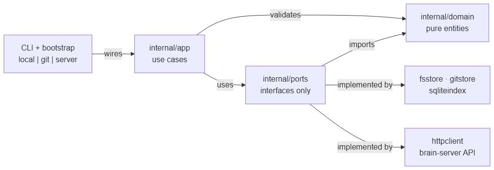
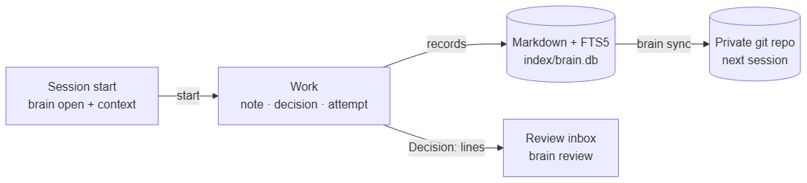
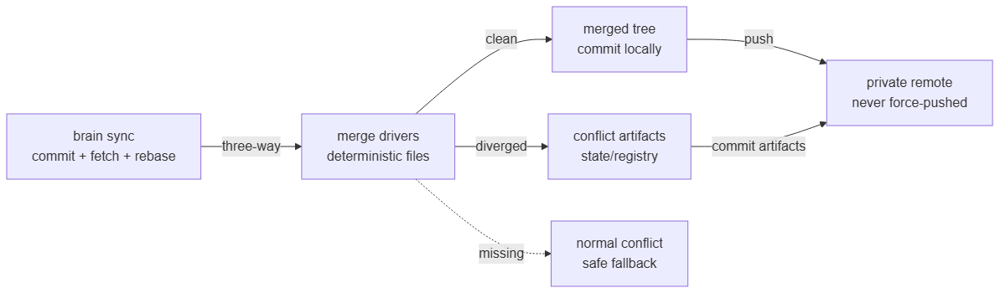
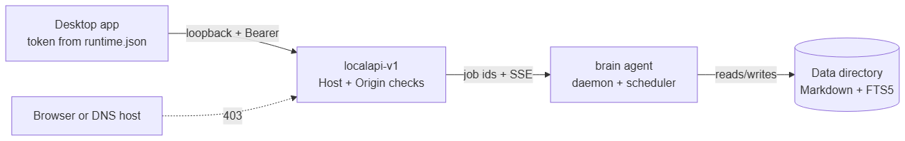

# LV24 Brain architecture

This is the front door for engineers and agents changing the system. The detailed, line-by-line
design remains in [architecture-deep.md](architecture-deep.md); the diagram index is
[architecture/README.md](architecture/README.md); the document map is [README.md](README.md).

## 1. Purpose and scope

LV24 Brain is a local-first project memory engine for people and coding agents. It stores a
project's state, notes, decisions, attempts, handoffs and ideas as Markdown with YAML
frontmatter, in a local directory or a private git repository, and exposes the same records through
a CLI, an MCP server and an optional HTTP server.

It does:

- carry context between agent sessions and machines: `brain open`, `brain context "<task>"`,
  `brain catchup`, `brain search`;
- keep curation reviewable: decisions, attempts, handoffs, supersede chains, proposals and review
  findings;
- sync a shared brain with ordinary git, including deterministic merge drivers;
- run as a single-node team server with Postgres, accounts, roles and per-project access.

It does not do: CRDT co-editing, multi-tenant SaaS, billing, a mobile app, paid hosting or CI,
automatic mail-body storage, or Rust components. Server mode is single-node; multi-replica
deployment is unsupported. The public repository never contains brain data.

## 2. System context and trust boundaries

| Actor or system | Interaction | Boundary |
|---|---|---|
| Human | CLI, Markdown, git | Owns the data directory and the private repo |
| Coding agent (Claude Code, Codex, OpenCode) | Session hooks, CLI, MCP stdio | Receives curated context only by default |
| MCP host | 18 `brain_*` tools and `memory://` resources | Stdout is protocol-only; diagnostics go to stderr |
| Desktop app (`lv24-brain-desktop`) | Loopback `localapi-v1` | Bearer token from an owner-only file, exact loopback Host |
| Private git remote | `brain sync` | Never force-pushed; conflicts become artifacts |
| GitHub, GitLab, IMAP, Jira, Slack, … | Read-only connectors | Raw items are untrusted external text |
| OIDC identity provider | Browser authorization code + PKCE | Server mode only; no CLI OIDC flow |
| Postgres | Server records, auth, audit, raw items | Internal Compose network, never published |

Trust is asymmetric: the public repo is product code; the data directory or private repository is
private content; credentials resolve at runtime from the environment or the OS secret store and are
never written to `brain.yaml`. Records from agents or connectors carry provenance and may be
quarantined; raw connector text is excluded from context until an explicit grant.

## 3. Three modes

`brain.yaml` selects one mode. The same use cases run in all three; only adapters change.

| Mode | Store and index | Sync | Auth | Use when |
|---|---|---|---|---|
| `local` | `fsstore` Markdown + SQLite FTS5 | none | none | One machine, a scratch brain, or a fully offline setup |
| `git` | `fsstore` + SQLite FTS5 | `gitstore`: fetch, rebase, commit, optional push | git remote ACL | Several machines or people, offline-first, reviewable history (recommended default) |
| `server` | HTTP API; Postgres when `BRAIN_DATABASE_URL` is set, in-memory otherwise | API + SSE; `brain sync` is unavailable | JWT, API tokens, OIDC, roles, per-project ACL | A team wants one shared service and central accounts |

Local and git modes require `data_dir`; server mode requires `server_url` and has no data directory.
`brain index` and `brain sync` are local/git only. `brain search` works in server mode through
`GET /v1/search`. Without a database URL the server deliberately uses its in-memory store and loses
data on restart.

## 4. Runtime components and the dependency rule



| Component | Responsibility |
|---|---|
| `cmd/brain` | CLI entry point, flag parsing, command dispatch |
| `cmd/brain-server` | HTTP server entry point and process wiring |
| `internal/app` | Use cases: init, open, bootstrap, context, write, review, sync, search, index, auth, update |
| `internal/ports` | Interfaces only: `Store`, `Index`, `SyncProvider`, `SecretStore`, `AuthProvider`, `Source`, `GraphIndex`, `RecordReviewer`, `Updater` |
| `internal/domain` | Pure entities, value objects and validation errors; no project or I/O imports |
| `internal/bootstrap` | Composition root; selects adapters by mode |
| `internal/adapters/*` | `fsstore`, `gitstore`, `sqliteindex`, `httpclient`, `httpapi`, `postgres`, `serverstore`, `oidc`, `secrets`, connectors, `localapi` |
| `internal/mcpserver` | MCP server over stdio: protocol 2026-07-28 and 2025-06-18 |
| `internal/daemon`, `agentcontrol` | Background connection agent and loopback control API wiring |
| `internal/mergedriver` | Deterministic git merge drivers for state, registry, notes and raw items |
| `internal/server` | Server configuration, migrations, retention, auth and process lifecycle |

The dependency rule is non-negotiable:

```text
cmd/* / internal/bootstrap   composition roots
internal/app                 use cases; depends on domain, ports, config
internal/ports               interfaces only
internal/domain              pure entities and validation errors
internal/adapters/*          implement ports; selected at bootstrap
```

Dependencies point inward: `domain` ← `ports` ← `app` ← `adapters`/`bootstrap` (the arrow points at
the package being depended on). `internal/domain` imports no project packages and no I/O libraries;
`internal/ports` depends only on the standard library and domain. Adapters never leak into domain or app.
An adapter that does not implement list methods still supports writes; context sections simply
report nothing.

## 5. Key flow: the session memory loop



1. At session start the hook or the human runs `brain open` (bootstrap pack, git and graph context)
   or `brain context "<task>"` (state, findings, latest handoff, best-matching records, failed
   attempts). Quarantined records are excluded unless requested.
2. The agent works in the checkout and writes back with `brain note`, `brain decision`,
   `brain attempt` and `brain handoff` (or the MCP equivalents).
3. Writes are redacted, validated and written atomically (temporary file + rename) into the data
   directory; new writes upsert the SQLite FTS5 index immediately.
4. The session-end hook captures a handoff. `Decision:` lines in the agent's final message become
   proposed records for `brain review`; they are not silently accepted.
5. `brain sync` commits, fetches, rebases and optionally pushes to the private data repository.
6. The next session, on any machine, reads the same curated state through the same commands.

## 6. Data ownership and storage

### 6.1 Markdown source of truth (`fsstore`)

```text
registry.json                          project index (managed by brain project)
context-allow.json                     explicit raw-context grants (no secrets; committed)
projects/<id>/state.md                 goal, active, blocked, next action, open questions
projects/<id>/notes/YYYY-MM-DD.md      dated note sections
projects/<id>/decisions/YYYY-MM-DD-<slug>.md
projects/<id>/attempts/YYYY-MM-DD-<slug>.md
projects/<id>/handoffs/YYYY-MM-DD-HHMMSS.md
projects/<id>/ideas/idea-YYYY-MM-DD-<slug>-<ULID>.md
projects/<id>/trash/ideas/<file>        reversible idea delete
proposals/<project>/<proposal-id>.md    machine-local candidates (git-ignored)
connectors/runs/<UTC>-<source>-<run-id>.md
index/brain.db                         derived SQLite FTS5 index
```

Every record carries `project_id`, `kind`, `updated_at`, `schema_version` and optional
`permalink`; decisions, attempts and handoffs also carry validity and provenance keys. The data
schema is version 1. Records keep stable ids; supersede chains are the audit log. Writes are
atomic, and a damaged daily notes file is moved to `<date>.md.corrupt-<n>` rather than blocking new
notes.

The index is derived data: `brain search` reads it, `brain index` refreshes it, `brain index
--rebuild` discards it. When a write cannot update it, or a pull changes records, the engine writes
`index/dirty`; sync reindexes immediately and the next search repairs it if that failed.
`brain doctor` warns while the marker is set.

The data revision (`CurrentRevision`) covers `brain.yaml`, `registry.json`, `global/` and
`projects/`, but not `secrets/`, `index/`, `backups/`, `mail/`, connector dumps, `journal/` or
`proposals/`. A digest or a mail sync therefore does not change the revision.

### 6.2 SQLite FTS5 (`sqliteindex`)

`index/brain.db` is local and git-ignored. It uses modernc SQLite with FTS5, stores the same
validity and provenance projection as records, and matches English and Russian word forms as
prefixes (`decisions` → `decision`, `решений` → `решение`). Local index schema is **11**. Raw
items, dumps and proposals are excluded from default search; `--kind item` (or `--dumps`) opts in.

### 6.3 Postgres (server mode)

Postgres is canonical in server mode. The server schema is **10**, forward-only, with embedded
migrations. Migrations run at startup; an existing schema with pending migrations refuses to start
until a backup is confirmed (`BRAIN_DATABASE_BACKUP_CONFIRMED=1`).

| Migration | Adds |
|---|---|
| `0002_auth_tokens.sql` | Durable API tokens and refresh-token families |
| `0003_auth_revocations.sql` | Family/session revocation tombstones with no expiry |
| `0004_security_audit.sql` | Security audit events outside revisions and SSE |
| `0005_knowledge_owner.sql` | Record `created_by` ownership |
| `0006_api_token_expiry.sql` | Nullable API-token expiry |
| `0007_search_fulltext.sql` | Generated `search_tsv` (`simple`, title weighted) |
| `0008_project_access.sql` | Per-project ACL, token scopes and project allow-lists |
| `0009_connector_items.sql` | Server raw zone: items, checkpoints, run metadata |
| `0010_record_provenance.sql` | Record `origin`, `reviewed`, `trust` |

Retention is an in-process job (audit default 180 days, revisions 90 days, interval 6 hours) and
can be disabled with `BRAIN_RETENTION_DISABLED=1`. Multi-replica deployment remains unsupported
even with durable tokens: the SSE broker and login rate limiter are per-process.

## 7. Git sync and merge artifacts



`brain sync` holds an interprocess lock on the data directory for the whole run. It commits
non-ignored changes, fetches, stashes a tree dirtied by a concurrent writer, rebases, restores the
stash, and pushes only with `--push`. A rejected push is retried up to three times with backoff and
always fetches and rebases first. It never force-pushes.

A conflict aborts the rebase, restores the autostash, prints the unmerged paths and exits **3**
(0 success, 1 runtime, 2 usage). A rebase or autostash left by a killed run is repaired at the start
of the next `App.Sync`, before the conflict pre-check, so no manual `git rebase --abort` is needed.

The data repository's `.gitattributes` routes single mutable files through deterministic three-way
drivers registered per clone by `brain init`, `brain doctor --fix` and the sync preflight:

| Driver | Files | Merge behavior |
|---|---|---|
| `lv24-state` | `projects/*/state.md` | Merge `goal` and `next_action`; union ordered lists; preserve unknown sections |
| `lv24-notes` | `projects/*/notes/*.md` | Union entries by heading and body hash; respect intentional deletion |
| `lv24-registry` | `registry.json` | Union projects and paths; keep the later `updated_at`; report alias/path claims |
| `lv24-items` | `connectors/*/items/*.md` | Normalize `observed_at`; keep a diverged copy as `*-<hash>.md` |

Driver-generated artifacts are committed in the same sync: `state-conflicts/` for a scalar both
sides changed, `registry-conflicts/` for a conflicting alias or path, and `notes/merge-conflicts/`
(or the `merges/` manifest) for records. `Status.ConflictRecords`, `sync --status --json` and
`brain doctor` report them; `unmerged` stays false so a preserved value is never reported as a
blocked sync. A clone without drivers falls back to a normal content conflict, which is safe.

## 8. Local control API and the desktop contract



`brain agent` is a foreground background engine: one process per data directory (OS lock), a
persisted schedule, a bounded worker pool, a parent-PID watchdog and rotating redacted logs under
`<data-dir>/agent/`. The same process owns the local control API wired by `internal/agentcontrol`
to `internal/adapters/localapi`.

- Listener: IPv4 loopback only, ephemeral port; `{port, token, pid, version}` is published in the
  owner-only `agent/runtime.json` (0600).
- Authentication: exactly one `Authorization: Bearer <token>`; the `Host` header must be exactly
  `127.0.0.1:<port>`. `localhost`, `[::1]`, another port or a DNS name is `403`.
- Any `Origin` or `Referer` header is rejected; there is no CORS, no preflight and no browser mode.
- JSON bodies are limited to 1 MiB and reject unknown fields. Requests and responses are never
  logged.
- Errors use a stable `{error:{code,message}}` envelope; method mismatches are `405` with `Allow`.
  A stale state compare-and-swap is `409 conflict` with `error.current_revision`.

The wire contract is frozen as **`localapi-v1`** and is additive only: `1.x` may add routes, never
remove or rename one. The machine-readable schema is
`internal/adapters/localapi/openapi.json`; the route table and semantics are in
[localapi-v1.md](localapi-v1.md). It covers connections, runs and logs (SSE), schedules, projects,
state with CAS, curated records, ranked search, review, quarantine, proposals, catchup, merge
plan/apply/rollback, digest, journal, hooks, sync, settings, engine update and shutdown.

The desktop app in `lv24-brain-desktop` is a consumer, not a dependency. The engine works without
it; the contract exists so the app can be replaced without changing the engine.

## 9. MCP server

`brain mcp` serves the brain over stdio. The default and only profile is `lv24`: **18 tools** plus
read-only `memory://` resources.

| Class | Tools |
|---|---|
| Read | `brain_open`, `brain_context`, `brain_search`, `brain_record`, `brain_catchup`, `brain_review`, `brain_projects`, `brain_graph`, `brain_capabilities` |
| Append | `brain_note`, `brain_decision`, `brain_attempt`, `brain_handoff` |
| Mixed | `brain_code`, `brain_idea` |
| Destructive | `brain_state`, `brain_judge`, `brain_prompt` (confirmation rules apply) |

Stdout carries protocol messages only; diagnostics go to stderr. The contract, refusal codes,
pagination and the retired 0.16 names are documented in [mcp.md](mcp.md). Raw excerpt reads are
local/git only and require an explicit `context-allow.json` grant; server mode never returns raw
items to viewers or members.

## 10. Server mode

`brain-server` is one Go binary using `net/http`. It fails fast on invalid configuration and
requires a JWT signing key of at least 32 bytes.

| Surface | Contract |
|---|---|
| Health | `GET /health`, `GET /ready`, `GET /version`, `GET /openapi.json` |
| Local auth | Argon2id passwords; HS256 access JWT (15-minute default); rotating refresh token (30-day default), reuse revokes the family |
| API tokens | `brain_` prefix, stored as SHA-256 hashes; scopes `read`/`write`/`admin`; optional project allow-list and expiry |
| OIDC | Authorization code with PKCE, `state` and `nonce`; browser flow only |
| Roles | Server-side on every route: `viewer` reads, `member` writes, `admin` manages users, roles and deletion |
| ACL | Per-project restriction rows and token allow-lists (migration `0008`) |
| Audit | `GET /v1/audit` (admin); security events never enter revisions or SSE |
| Events | `GET /v1/events` SSE with retry, ready, revision events, heartbeat and `Last-Event-ID` replay; header auth or a single-use one-minute ticket from `POST /v1/events/ticket` |
| Search | Postgres full-text over generated `search_tsv`, ranked before `LIMIT`; raw item hits for admins only |

The authenticated login is attached to the request context through `ports.WithActor`, so revisions
and audit rows record who made the change. `brain sync` and `brain index` are unavailable in server
mode: the API is the sync path. There is no server-side Markdown import/export, no CLI OIDC flow
and no server auto-update; upgrades replace the image.

## 11. Deployment

`deploy/docker-compose.yml` runs `brain-server` and Postgres 17 (pinned by digest) with
healthchecks. Compose supplies `BRAIN_DATABASE_URL`, so the stack uses Postgres. Postgres is
reachable only on the Compose network: **never publish 5432**.

- Default host publish is `127.0.0.1:8080` (`BRAIN_BIND_ADDR`, `BRAIN_PORT`); terminate TLS at a
  reverse proxy.
- Release images are published to `ghcr.io/levapveeskela/lv24-brain-server` for `linux/amd64` and
  `linux/arm64`, tagged `X.Y.Z`, `X.Y` and `latest` for stable releases.
- The container runs read-only apart from `/tmp` and the `brain_data` volume, as UID/GID `10001`,
  with `no-new-privileges`.
- `BRAIN_JWT_SECRET` (32+ bytes), `BRAIN_DATABASE_URL` and the matching `BRAIN_DB_PASSWORD` are
  required. Secrets belong in `deploy/.env`, which is never committed.
- Optional Prometheus metrics listen on `BRAIN_METRICS_ADDR` (default `127.0.0.1:9090`) and have no
  authentication; keep that listener private.

Smoke: `curl -fsS http://127.0.0.1:8080/health`, `/ready`, `/version`. The full environment table is
in [deploy.md](deploy.md).

## 12. Invariants and failure modes

| Invariant | Enforcement |
|---|---|
| Dependencies point inward; domain is pure | Package layout and review; ports import only context, time, domain |
| The public repo never holds brain data or secrets | Separate data repo; `.gitignore`; runtime secret resolution; redaction before persistence |
| Stdout is protocol-only for MCP | `internal/mcpserver` writes diagnostics to stderr; tests reject non-JSON stdout lines |
| Writes are atomic and the index is derived | Temp file + rename; `index/dirty`; search-time repair; corrupt files reported, not silently dropped |
| Sync never force-pushes | `gitstore` argument-vector CLI calls; retry fetch + rebase; exit 3 on conflict |
| Conflicts are preserved | Merge drivers write artifacts and commit them; nothing is dropped silently |
| `localapi-v1` is frozen and additive | OpenAPI schema, pinned operations file and contract tests |
| The local API is not a browser surface | Loopback only, exact Host, any Origin/Referer rejected, no CORS |
| Server migrations are forward-only | Startup check; backup confirmation; no down migrations |
| Postgres stays private; server is single-node | Compose network only; no 5432 publish; per-process SSE and login limiter |

Failure modes worth knowing:

- **No `BRAIN_DATABASE_URL`:** the server uses `httpapi.MemoryStore`; data and tokens disappear on
  restart. Connector runs return `unsupported` instead of pretending to store items.
- **Interrupted index update:** `index/dirty` remains; sync reindexes, search repairs, doctor warns.
- **Missing merge drivers:** git falls back to a normal content conflict. Safe, but not automatic.
- **Unmerged git conflict:** `brain sync` exits 3 and leaves the paths visible; fix them and re-run.
- **Raw-zone deletes:** providers never infer deletes without an authoritative tombstone. A missing
  item is not removed automatically.
- **Server auto-update:** `BRAIN_SERVER_AUTO_UPDATE` is reserved; deployments upgrade by replacing
  the image.
- **Multi-replica:** unsupported. SSE events and login throttling are per process.

## 13. Extension points

| Change | Safe path |
|---|---|
| New store, index, sync or secret backend | Implement the relevant `internal/ports` interface; select it in `internal/bootstrap`; add adapter tests with temporary directories |
| New connector source | Implement `ports.Source`; register it in `internal/connectorbuild`; keep runs idempotent, bounded and delete-honest; add the connection provider metadata |
| New use case or CLI command | Add the use case in `internal/app`; wire it in `cmd/brain`; document it in the CLI reference; keep exit codes 0/1/2/3 |
| New HTTP route | Add it in `internal/adapters/httpapi`, update `openapi.json`, add authz and audit tests |
| New MCP tool | Extend `internal/mcpserver/profile.go` and `tools.go`; update the contract and surface tests; the profile is additive and stdout stays protocol-only |
| New local API route | Additive only: update `internal/adapters/localapi/openapi.json`, the pinned `testdata/localapi-v1.operations`, the route table in `localapi-v1.md`, and the contract tests |
| New merge driver | Add it in `internal/mergedriver`, register it in `gitstore` and `brain init`/`doctor --fix`, and cover both diverged sides |
| New Postgres table or column | Add an embedded forward-only migration and bump `postgres.SchemaVersion`; never rewrite an applied migration |

## 14. Related documents and decisions

- Deep implementation detail and known gaps: [architecture-deep.md](architecture-deep.md)
- Product source of truth: [product-design.md](product-design.md)
- Local desktop contract: [localapi-v1.md](localapi-v1.md)
- MCP surface: [mcp.md](mcp.md)
- Server deployment: [deploy.md](deploy.md)
- Security and privacy: [security.md](security.md)
- Team operations: [runbook.md](runbook.md)
- Current status and release history: [status.md](status.md)
- Documentation site: <https://brain.lv24.by>
- Diagram index: [architecture/README.md](architecture/README.md)
- Brain project id for this repository: `lv24-brain`
