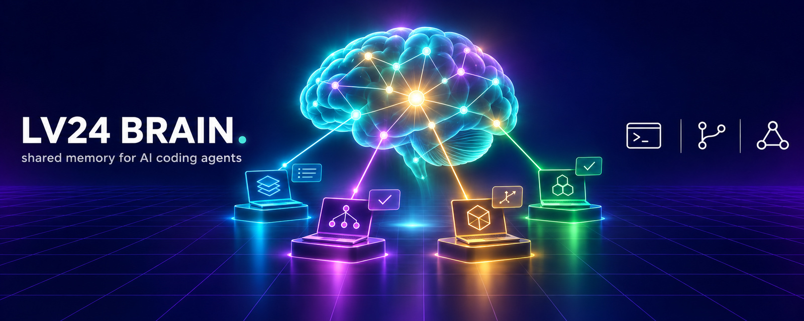

# lv24-brain

> **Your coding agents forget everything between sessions. LV24 Brain doesn't.**
> Claude Code, Codex and OpenCode start every session with the project's memory
> and write back what they decided, what failed and what comes next.

**LV24 Brain** is a curated project memory for coding agents and people:
state, decisions, failed attempts and handoffs of every project, searchable
and shared across machines. Works locally, through a private git repository,
or against a team server. Claude Code, Codex and OpenCode use it through
session hooks and an MCP server.

**Documentation: <https://brain.lv24.by>**

## Install

```bash
npm i -g lv24-brain
brain version
```

npm installs only the binary for your platform (`@lv24/brain-<os>-<cpu>`:
Windows, macOS and Linux on x64 and arm64). Nothing is downloaded at install
time and no install scripts run. Update with `npm i -g lv24-brain@latest`;
`brain update` defers to npm for npm installs.

Standalone installers with signature checks are described in the
[install guide](https://github.com/LevapVeeskela/lv24-brain/blob/main/docs/install.md).

## Quick start

```bash
brain init --mode local --data-dir ~/brain   # or --mode git / --mode server
brain project set my-app --path ~/src/my-app
cd ~/src/my-app && brain open .  # state, decisions, attempts, last handoff
brain note "switched auth to OIDC"
brain decision "Use Postgres FTS" --context "..." --alternatives "a,b"
brain search "auth"
brain handoff "done: login page" --next "wire the logout button"
```

Connect agents: `brain agents sync --hooks` installs session hooks, and
`brain mcp` serves the same commands as MCP tools.

## Main features

- Markdown + YAML records with a full-text index (SQLite FTS5).
- Git sync across machines; team server with per-project access control and
  scoped API tokens.
- Secret redaction on every write; `Decision:` lines from sessions land in a
  review inbox.
- `brain review`, `brain digest`, `brain catchup` keep the knowledge fresh.

Documentation: <https://brain.lv24.by>

Team server image (linux/amd64, linux/arm64): `ghcr.io/levapveeskela/lv24-brain-server`.

Source and changelog: <https://github.com/LevapVeeskela/lv24-brain>. License: Apache-2.0.
